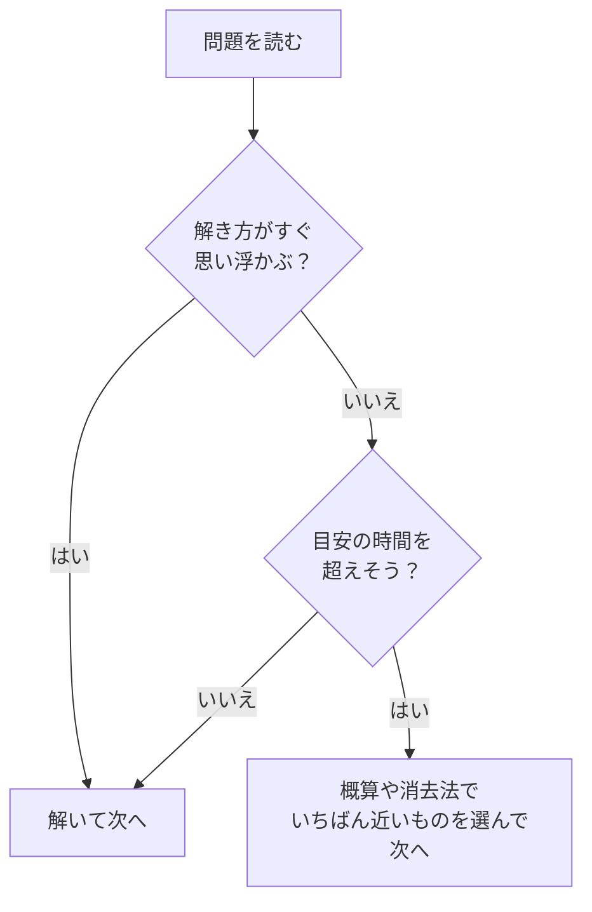

## はじめに：準備で差がつく

玉手箱も TG-WEB も、問題そのものの難しさより**時間の短さ**が壁になります。電卓の扱いに慣れているか、わからない問題で止まらないか。こうした準備と習慣だけで、正答数は大きく変わります。

## 受検前にそろえるもの

| もの | ポイント |
|---|---|
| 電卓 | キーが大きく押しやすい、ふつうの電卓。スマートフォンの電卓アプリは画面の切り替えで時間を失うので避ける |
| メモ用紙と筆記用具 | 図表の数値や途中の計算を書き留める。A4 の紙を数枚 |
| パソコン | スマートフォンでは画面が小さく、図表や長文が読みにくい |
| 通信環境 | 途中で切れないよう、安定した回線で受ける |
| 静かな場所 | 家族に声をかけられない時間を確保する |

注意：決まりは受け方によって違う

監視型やテストセンターでは、電卓やメモ用紙の持ち込みが制限されることがあります。受検案内の注意書きに従ってください。また、**ほかの人に代わりに受けてもらう、友人と相談しながら解く、といった行為は不正**です。発覚すれば内定の取り消しなどにつながるおそれがあります。

## 電卓を速く使うコツ

計数の問題は電卓を使う前提で作られています。使い方を少し工夫するだけで、1 問あたり数秒ずつ短くなります。

- **左手で電卓、右手でマウス**（利き手が左なら逆）。持ち替える時間をなくします
- **メモリー機能**：`M+` で足し込み、`M−` で引き、`MR` で呼び出し。「A × B + C × D」のような計算を、途中の数を書き留めずに計算できます
- <strong>% キーは使わない</strong>：機種によって動きが違います。「35%」は「× 0.35」と打つほうが確実です
- **割り算の順番**：「A ÷ B」の B が複雑な式のときは、先に B を計算してメモリーに入れ、A を打ってから `÷ MR` とします

例：メモリー機能で「120 × 35 + 80 × 45」

`120 × 35 M+` → `80 × 45 M+` → `MR` と押すと、答えの 7,800 が表示されます。途中の 4,200 と 3,600 を書き留める必要がありません。

## 1 問あたりの時間を知っておく

形式ごとに、1 問にかけられる時間はおおよそ決まっています。**この時間を体で覚えておく**ことが、本番で焦らないための準備になります。

| テスト | 形式 | 問題数・時間 | 1 問あたり |
|---|---|---|---|
| 玉手箱 | 四則逆算 | 50 問・9 分 | 約 11 秒 |
| 玉手箱 | 図表の読み取り | 29 問・15 分 | 約 31 秒 |
| 玉手箱 | 表の空欄推測 | 20 問・20 分 | 約 60 秒 |
| 玉手箱 | 論理的読解（GAB） | 32 問・15 分 | 約 28 秒 |
| 玉手箱 | 趣旨判定（IMAGES） | 32 問・10 分 | 約 19 秒 |
| 玉手箱 | 英語 | 24 問・10 分 | 約 25 秒 |
| TG-WEB 従来型 | 計数 | 9 問・18 分 | 約 2 分 |
| TG-WEB 従来型 | 言語 | 12 問・12 分 | 約 1 分 |
| TG-WEB 新型 | 計数 | 36 問・8 分 | 約 13 秒 |
| TG-WEB 新型 | 言語 | 34 問・7 分 | 約 12 秒 |

このサイトの練習問題では、1 問ごとにかかった時間と本番の目安を表示します。**目安を超えた問題は、解き方そのものを見直す**きっかけにしましょう。

## わからない問題で止まらない

1 問に時間をかけすぎると、その後の解けるはずの問題に手が回らなくなります。

- **空欄で終わらせない**：誤答で減点されるかどうかは公表されていません。一般的には、時間切れで空欄を残すより、概算や消去法で選んで進むほうがよいとされています
- **前の問題に戻れないことが多い**：WEB テストでは、一度次へ進むと戻れない形式が多いとされています。「後で見直す」は期待しないで、その場で決めましょう

コツ：残り時間の目安を決めておく

たとえば四則逆算（50 問・9 分）なら、「3 分で 17 問、6 分で 34 問」が目安です。このサイトの「本番形式」では、目安のペースより何問進んでいるか（遅れているか）を表示します。

## 受検の前日までにやること

1. 受けるテストと形式のレッスンを読む
2. 練習問題で、**解き方の手順を体に覚えさせる**（最初は時間を気にしない）
3. 「本番形式」で、**本番と同じ問題数・時間**で 1 回以上解く
4. 間違えた問題を「復習」で解き直す
5. 電卓・メモ用紙・パソコンの準備を確認する

やってみよう（10 分）

ふだん使う電卓で、メモリー機能（`M+`・`M−`・`MR`）を試してみましょう。そのあと「はじめに」の「計算の基礎」の練習問題を、電卓を使って 10 問解いてみてください。

## まとめ

- 電卓・メモ用紙・パソコン・安定した通信環境をそろえる。**決まりは受検案内に従う**
- 電卓は利き手と反対の手で。**メモリー機能**を使いこなす
- 形式ごとの **1 問あたりの時間**を覚え、目安を超えそうなら選んで次へ進む
- 受検の前に、**本番形式で時間を計って解いておく**
