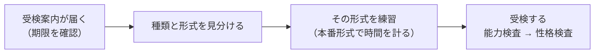

## はじめに：まず「何を受けるのか」を知る

WEB テストには、SPI、玉手箱、TG-WEB など、いくつもの種類があります。種類によって問題の形式がまったく違うので、**受けるテストを見分けてから、その形式に絞って練習する**のがいちばんの近道です。

このサイトで扱うのは、次の 2 つです。

| テスト | 提供元 | 特徴 |
|---|---|---|
| 玉手箱 | 日本エス・エイチ・エル（SHL） | 同じ形式の問題を、短い時間で大量に解く |
| TG-WEB | ヒューマネージ | 従来型は少ない問題数の難問、新型はやさしい問題を超短時間で解く |

このサイトの情報について

問題数・制限時間・見分け方は、就活情報サイトなどで広く紹介されている一般的な情報です。テストの提供元が細かい仕様を公表しているわけではなく、企業によって異なることもあります。**受検案内のメールや画面の表示を必ず確認**してください。

## 手がかり 1：受検案内のメールと URL

受検案内のメールに書かれている URL は、テストの種類を見分ける手がかりになります。就活情報サイトでは、次のような例がよく紹介されています。

| テスト | URL の例 |
|---|---|
| 玉手箱 | `web1.e-exams.jp`、`tsvs1.e-exams2.jp`、`nsvs1.e-exams4.jp` など |
| TG-WEB | `assessment.c-personal.com`、`assessment.e-gitest.com` など |

ひっかけ注意：URL だけで決めつけない

同じ URL で、別のテスト（たとえば玉手箱と CAB）が実施されることがあるとされています。URL は「たぶんこれ」という見当をつけるためのものと考え、**受検画面の表示と最初の問題の形式で確かめましょう**。

## 手がかり 2：制限時間と問題数

受検を始めると、科目ごとの問題数と制限時間が表示されることが多いです。**時間と問題数の組み合わせで、形式がほぼわかります**。

### 玉手箱

| 科目 | 問題数・時間 | 形式 |
|---|---|---|
| 計数 | 50 問・9 分 | 四則逆算 |
| 計数 | 29 問・15 分（または 40 問・35 分） | 図表の読み取り |
| 計数 | 20 問・20 分（または 35 問） | 表の空欄推測 |
| 言語 | 32 問・15 分 | 論理的読解（GAB 形式） |
| 言語 | 32 問・10 分 | 趣旨判定（IMAGES 形式） |
| 言語 | 10 問・12 分 | 趣旨把握 |
| 英語 | 24 問・10 分 | 論理的読解 または 長文読解 |

玉手箱の計数と言語は、**それぞれ 1 つの形式だけ**が出題されます。最初の問題が四則逆算なら、最後まで四則逆算です。

### TG-WEB

| 科目 | 従来型 | 新型 |
|---|---|---|
| 計数 | 9 問・18 分 | 36 問・8 分 |
| 言語 | 12 問・12 分 | 34 問・7 分 |
| 英語 | 10 問・15 分 | 10 問・15 分（従来型と同じ） |

TG-WEB は **URL では従来型と新型を区別できない**とされています。計数が 18 分なら従来型、8 分なら新型、というように**制限時間で見分けます**。

コツ：練習の順番を決める

受けるテストが決まっていないなら、玉手箱の 3 形式（四則逆算・図表の読み取り・表の空欄推測）と TG-WEB 従来型の計数から始めるのがおすすめです。どちらも初見では時間内に解けず、**練習の効果がいちばん大きい**からです。

## 手がかり 3：受検のしかた

同じ玉手箱や TG-WEB でも、受け方にはいくつかの種類があります。

| 受け方 | 内容 |
|---|---|
| 自宅受検 | 自分のパソコンで受ける。いちばん多い形 |
| 監視型 | カメラなどで受検の様子を確認する。TG-WEB では「TG-WEB eye」、玉手箱では「C-GAB plus」という名前が紹介されることがある |
| テストセンター | 指定の会場で受ける。玉手箱のテストセンター版は C-GAB と呼ばれる |

監視型やテストセンターでは、持ち込めるもの（電卓・メモ用紙など）に決まりがあります。**受検案内の注意書きを必ず読んでください**。

## 受検の流れ

1. **期限を確認する**：受検の締め切りは 1 週間前後のことが多いです。締め切り直前はアクセスが集中することもあるので、余裕を持って受けましょう。
2. **種類と形式を見分ける**：このレッスンの手がかりを使います。
3. **練習する**：このサイトの各形式のレッスンを読み、練習問題と「本番形式」で時間の感覚をつかみます。
4. **受検する**：能力検査のあとに性格検査があるのが一般的です。性格検査は「性格検査」のレッスンを読んでおきましょう。

やってみよう（5 分）

届いている受検案内（またはこれから受ける予定の企業の情報）を見て、次の 3 つを書き出してみましょう。

- テストの種類（玉手箱か、TG-WEB か、それ以外か）
- 受検の締め切り
- 受け方（自宅・監視型・テストセンター）と、持ち込めるもの

## まとめ

- テストの種類によって問題がまったく違うので、**まず見分けてから練習する**
- URL は見当をつける手がかり。**制限時間と最初の問題**で確かめる
- 玉手箱の計数・言語は **1 つの形式だけ**が出る。TG-WEB は**制限時間で従来型と新型を見分ける**
- 受け方によって持ち込めるものが違うので、**受検案内を必ず確認する**
