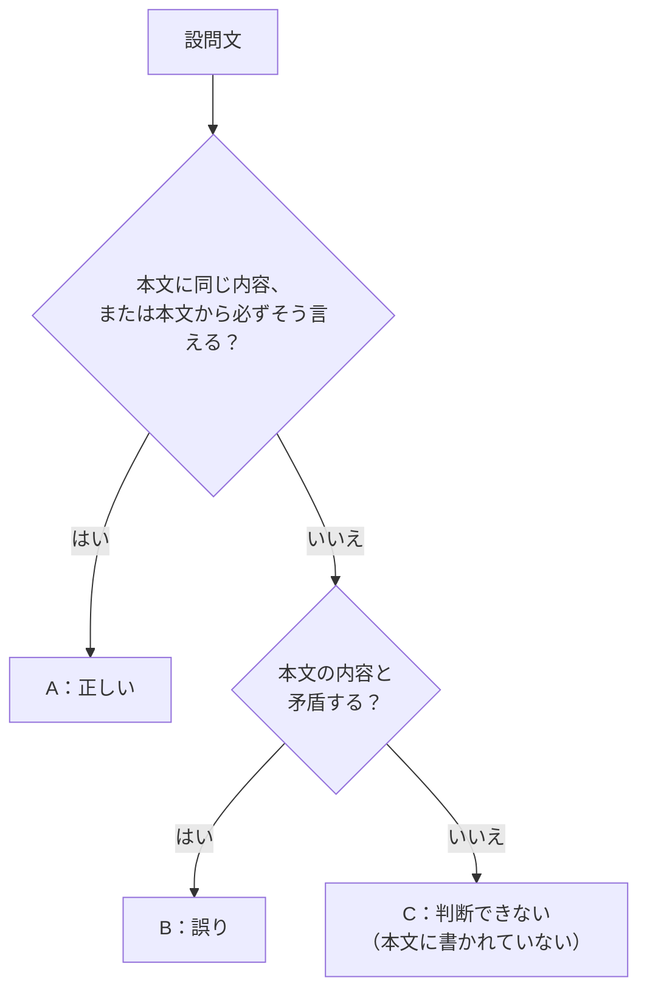

## はじめに：自分の知識を使わない

論理的読解（GAB 形式）は、**1 つの文章を読み、4 つの設問文について、次の 3 つのどれに当たるかを答える**形式です。32 問（8 文章）・15 分、1 問あたり約 28 秒です。

| 選択肢 | 意味 |
|---|---|
| A | 本文から論理的に考えて、設問文は明らかに**正しい** |
| B | 本文から論理的に考えて、設問文は明らかに**誤っている** |
| C | 本文の内容だけからは、**判断できない** |

いちばん大切なルールは、**本文に書かれていることだけで判断する**ことです。常識や自分の知識で「正しそう」と思っても、本文に根拠がなければ C です。

## 3 つの見分け方

例題

<strong>本文（一部）</strong>：「テレワークを導入した企業の多くは、社員の満足度が上がったと報告している。一方で、生産性については評価が分かれている。」

1. 「テレワークを導入した企業の中には、社員の満足度が上がったと報告している企業がある。」→ **A**（「多く」が報告しているなら「中にはある」は必ず言える）
2. 「テレワークの導入によって、すべての企業で生産性が上がった。」→ **B**（「評価が分かれている」と矛盾する）
3. 「テレワークを導入した企業の半数以上が、生産性が下がったと回答した。」→ **C**（割合は書かれていない）

## B と C の区別がいちばん難しい

迷いやすいのは「本文に書かれていない」ときに、それが B なのか C なのかです。

- <strong>B（誤り）</strong>：本文の内容と**両立しない**。本文が正しいなら、設問文は必ず間違いになる
- <strong>C（判断できない）</strong>：本文の内容と**両立しうる**。正しいかもしれないし、間違いかもしれない

ひっかけ注意：「すべて」「必ず」「だけ」

本文が「多くの」「〜こともある」と言っているのに、設問文が「すべての」「必ず」と言い切っていたら、ふつうは **B** です。反対に、本文が「すべて」と言っていて設問文が「一部の」なら **A** です。**範囲を表す言葉**に注目しましょう。

ひっかけ注意：比較・原因・数値は C になりやすい

「A より B のほうが多い」「〜が原因で」「半数以上」のような、**比較・因果関係・具体的な数値**は、本文に書かれていなければ C です。本文に「A と B がある」とあっても、どちらが多いかは判断できません。

## 速く解くための読み方

1. **本文をざっと読む**（30〜40 秒）：各段落が何について書いているかをつかむ
2. **設問文のキーワードで本文を探す**：設問文の言葉が本文のどこに出てくるかを探し、その前後だけを丁寧に読む
3. **3 つの判断の流れに当てはめる**：「同じ内容か」→「矛盾するか」→ どちらでもなければ C

コツ：言いかえに気をつける

設問文は、本文の表現をそのまま使わず、**言いかえて**いることが多いです。「排熱が多いことが原因の一つ」→「排熱は原因の一つである」のように、意味が同じなら A です。

## 時間配分

- 1 文章（4 問）あたり約 1 分 50 秒
- 本文を読むのに 40 秒、1 問あたり 15〜20 秒が目安
- 迷った問題は「C」に逃げがちですが、**C が多すぎるときは見直しのサイン**です。このサイトの問題では、A・B・C がおおよそ同じくらいの割合で出ます

やってみよう（15 分）

練習問題を 2 文章（8 問）解きましょう。答え合わせのとき、B と C を間違えた問題は「本文と両立しうるか」を考え直してください。

## まとめ

- **本文に書かれていることだけ**で判断する。常識や知識は使わない
- 同じ内容・必ず言える → **A**、矛盾する → **B**、どちらでもない → **C**
- 「すべて」「必ず」などの**範囲の言葉**と、**比較・因果・数値**に注意
- 設問文のキーワードで本文を探し、その前後を丁寧に読む
