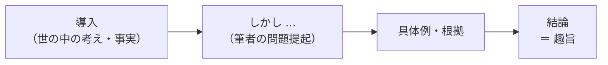

## はじめに：「書いてあるか」ではなく「一番言いたいことか」

趣旨判定（IMAGES 形式）は、**1 つの文章を読み、4 つの設問文が次のどれに当たるかを答える**形式です。32 問（8 文章）・10 分、1 問あたり約 19 秒と、とても速いペースが求められます。

| 選択肢 | 意味 |
|---|---|
| A | 筆者が<strong>一番訴えたいこと（趣旨）</strong>が述べられている |
| B | 本文に**書かれているが、一番訴えたいことではない** |
| C | 本文とは**関係のない**ことが書かれている |

論理的読解（GAB 形式）とよく似ていますが、聞かれていることが違います。GAB は「正しいか」、IMAGES は「**筆者の主張の中心か**」です。

## 趣旨の見つけ方

趣旨は、たいてい次の場所にあります。

- **最後の段落**（「〜すべきだ」「〜が大切だ」「〜なのである」）
- **逆接の後**（「しかし」「だが」「ところが」の後に筆者の意見がくる）
- <strong>「つまり」「このように」の後</strong>（まとめ）

例題

**本文の流れ**：「速く読む方法の本が人気だ（導入）。しかし、読書の価値は情報の量だけでは決まらない（問題提起）。時間をかけて読むことで考えが深まる（根拠）。速さばかりが求められる時代だからこそ、時間をかけて読む経験を意識して持つことが大切だ（結論）。」

1. 「時間をかけて考えながら読む経験を大切にすべきだ。」→ **A**（結論と同じ）
2. 「速く読む方法を紹介する本が人気を集めている。」→ **B**（書かれているが導入の事実）
3. 「電子書籍より紙の本のほうが記憶に残る。」→ **C**（本文に出てこない）

## B を見分けるポイント

本文に書かれている内容のうち、**趣旨ではないもの**が B です。次のようなものが B になります。

- **導入**で紹介された一般的な考えや事実
- 筆者が**否定するために**挙げた考え（「〜と考えられがちだ。しかし…」の前半）
- 主張を支える**具体例や根拠**
- 「もちろん〜」「確かに〜」で始まる**譲歩**

ひっかけ注意：正しい内容でも B

「散歩をしているときにアイデアが浮かぶことがある」のように、本文に書かれていて内容としても正しい文が B になることがあります。**正しいかどうかではなく、筆者の主張の中心かどうか**で判断しましょう。

ひっかけ注意：趣旨を言い過ぎたものは C

趣旨が「休む時間も意識して確保すべきだ」なのに、設問文が「毎日 7 時間以上眠るべきだ」となっていたら、本文に書かれていないので **C** です。主張と似た方向でも、**本文にない具体的な内容**は関係ないものと判断します。

## 速く解くための読み方

1. **最後の段落を先に読む**：趣旨のある場所の見当をつけます
2. **全体をざっと読む**：「しかし」「つまり」などの接続語に印象を残しながら
3. 設問文を読み、**趣旨と同じ → A、本文にある → B、本文にない → C** と判断

コツ：1 文章に A は 1 つとは限らない

このサイトの練習問題では 1 文章に A が 1 つのことが多いですが、本番では 2 つあったり、1 つもなかったりすることもあるとされています。「A は 1 つのはず」と決めつけず、1 問ずつ判断しましょう。

## 時間配分

- 1 文章（4 問）あたり約 75 秒
- 本文を読むのに 35 秒、1 問あたり 10 秒が目安
- GAB 形式よりも速く読む必要があるので、**細部は読み飛ばし、話の流れと結論をつかむ**ことに集中します

やってみよう（15 分）

練習問題を 2 文章（8 問）解きましょう。解く前に、本文の「結論の一文」に線を引くつもりで探してから設問に進んでください。

## まとめ

- 聞かれているのは「正しいか」ではなく「**筆者が一番訴えたいことか**」
- 趣旨は**最後の段落・逆接の後・まとめの言葉の後**にあることが多い
- 導入・例・根拠・譲歩は **B**、本文にない内容は **C**
- 最後の段落を先に読んで、趣旨の見当をつけてから全体を読む
