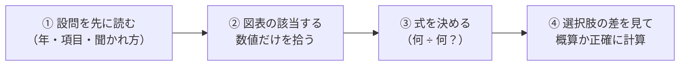

## はじめに：「どの数字を使うか」が 9 割

図表の読み取りは、**表やグラフを見て、問われた数値を計算する**形式です。29 問・15 分（1 問約 31 秒）または 40 問・35 分（1 問約 52 秒）で出題されます。

計算自体は「計算の基礎」で学んだ割合の計算です。時間がかかる原因の多くは、**表の中から使う数字を探すこと**と、**どの数で割るかを迷うこと**にあります。

## 解き方の手順

1. **設問を先に読む**：「何年の」「どの項目の」「何を（増加率・割合・倍率）」を確認します
2. **表の該当する数値だけを拾う**：表全体を読む必要はありません。単位（億円・千人など）も確認します
3. **式を決める**：下の表のどれに当てはまるかを判断します
4. **選択肢の差を見て計算の精度を決める**

## よく出る聞かれ方と式

| 聞かれ方 | 式 |
|---|---|
| 前年に比べて約何 % 増加（減少）したか | (今年 ÷ 前年 − 1) × 100 |
| 合計に占める割合は約何 % か | その項目 ÷ 合計 × 100 |
| A 年は B 年の約何倍か | A 年 ÷ B 年 |
| 約いくら増えたか | 後の年 − 前の年 |
| 1 年あたりの平均は | 合計 ÷ 年数 |
| （構成比の表で）実数はいくらか | 全体 × 構成比 |

例題 1：前年比

ある会社の売上高が、2024 年 468 億円、2025 年 523 億円だった。2025 年は前年に比べて約何 % 増加したか。

**解き方**：523 ÷ 468 ≒ 1.118 → **約 11.8% の増加**

例題 2：構成比の表から実数の変化

| | 2015 年 | 2025 年 |
|---|---|---|
| 製造業（%） | 22.0 | 19.5 |
| 合計（千人） | 5,200 | 6,100 |

製造業の就業者は約何千人増えたか。

**解き方**：2015 年 5,200 × 0.22 = 1,144、2025 年 6,100 × 0.195 ≒ 1,190 → **約 46 千人の増加**

ひっかけ注意：構成比どうしで計算しない

例題 2 で「19.5 − 22.0 = −2.5% だから減った」と考えるのは誤りです。**合計の人数が増えているので、実数は増えています**。構成比の表では、必ず**合計 × 構成比で実数に戻してから**比べましょう。

ひっかけ注意：「増加数」と「増加率」

「増加数が最も大きいのは」と聞かれたら**差**、「増加率が最も大きいのは」と聞かれたら**割合**です。もとの数が小さい項目は、増加数が小さくても増加率は大きくなります。

## グラフの読み方

- **棒グラフ・折れ線グラフ**：数値が書かれていれば、それを使います。目盛りから読み取る場合は、選択肢の差が大きいことがほとんどです
- **円グラフ**：「総額」と「割合（%）」から、総額 × 割合 で実数を求めます。2 つの項目の差は、**割合の差を先に求めてから**総額を掛けると 1 回の計算で済みます

例題 3：円グラフ

費用の総額 3,100 万円のうち、材料費 16%、その他 19%。材料費とその他の差は？

**解き方**：19% − 16% = 3% → 3,100 × 0.03 = **93 万円**

## 概算のしかた

コツ：選択肢の差が 10% 以上なら概算

選択肢が「8.5%、11.8%、15.2%、18.4%、21.7%」のように離れていれば、523 ÷ 468 を「520 ÷ 470 ≒ 1.1 くらい」と見積もるだけで 11.8% が選べます。差が小さいときだけ電卓で正確に計算しましょう。

- 割り算は、**上 2〜3 桁**に丸めて計算すれば十分なことが多い
- 「約何倍か」は、1.3 倍と 1.35 倍のように近い選択肢が並ぶことがあるので、小数第 2 位まで計算する

## 時間配分

- 29 問・15 分なら **5 分で約 10 問**が目安
- 1 つの表で複数の問題が出ることがあります。2 問目以降は表を探す時間が減るので、**1 問目で表の構成（行・列・単位）をつかんでおく**と速くなります
- 計算が複雑で 1 分以上かかりそうなら、概算で選んで次へ

やってみよう（20 分）

1. 練習問題を 10 問、「設問 → 数値を拾う → 式 → 選択肢を見る」の順で解く
2. 間違えた問題は、**割る数**と**構成比を実数に戻したか**を確認する
3. 「本番形式」（29 問・15 分）に挑戦する

## まとめ

- **設問を先に読み**、必要な数値だけを図表から拾う
- 増加率は**前の年で割る**、構成比の表は**合計 × 構成比で実数に戻す**
- 「増加数」と「増加率」、「実数」と「構成比」の違いに注意
- **選択肢の差を見て**、概算で済ませるか正確に計算するかを決める
