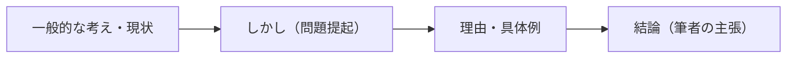

## はじめに：評論文の「型」を知る

TG-WEB 従来型の長文読解では、**やや硬い評論文**が出ます。1 つの文章に 2〜3 問がセットで出題され、筆者の主張（要旨）、内容と合うもの、空欄に入る語句などが問われます。

評論文の多くは、次のような流れで書かれています。

この流れを知っておくと、**主張がどこにあるか**の見当がすぐにつきます。

## 設問の種類と解き方

### 要旨・筆者の主張

- **最後の段落**と、<strong>「しかし」「だが」の後</strong>を中心に読む
- 不正解の選択肢は、「言い過ぎ」「逆の内容」「具体例だけ」「本文にない」のどれかであることが多い（玉手箱の「趣旨把握」と同じ考え方）

### 内容と合うもの（内容一致）

- 選択肢の**キーワードで本文を探し**、その前後と比べる
- 「すべて」「必ず」などの言い過ぎ、本文と逆の内容に注意

### 空欄補充（接続詞など）

- 空欄の**前後の文の関係**で決める（「空欄補充」のレッスンを参照）
- 段落の頭の空欄は、**前の段落全体と後の段落全体**の関係を見る

例題（空欄）

第 2 段落で「便利さには代償がある」と述べた後、第 3 段落が「（　）、便利さを否定する必要はない。」で始まる。

**解き方**：前の段落の主張に**制限を加えて補っている**ので、「もっとも」が入ります。「しかし」も逆接ですが、前の内容を打ち消すのではなく「ただし書き」を加えているので「もっとも」が適切です。

ひっかけ注意：筆者が認めている内容

「便利さを否定する必要はない」「記録には確かに価値がある」のように、筆者が**一部を認めている**文章では、「便利さを捨てるべきだ」「記録すべきではない」といった極端な選択肢は不正解です。

## 読み方の手順

1. **設問を先に読む**（選択肢はまだ見ない）
2. **本文を読む**：段落ごとに「何について書いているか」を一言でつかむ
3. 設問ごとに、**本文の根拠となる部分**を見つけてから選択肢を選ぶ

コツ：段落の役割をメモする

「1 段落目：現状、2 段落目：問題点、3 段落目：結論」のように、段落の役割を短くメモしておくと、設問を解くときに読み返す場所がすぐにわかります。

やってみよう（15 分）

練習問題を 2 文章分解きましょう。本文を読みながら、各段落の役割を一言でメモしてから設問に答えてください。

## まとめ

- 評論文は「現状 → しかし → 理由・例 → 結論」の流れが多い
- 主張は**最後の段落と逆接の後**。極端な選択肢は不正解になりやすい
- 内容一致は**キーワードで本文を探して比べる**
- 設問を先に読み、**段落の役割**をつかみながら読む
